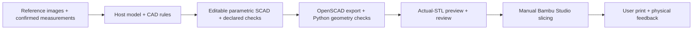

# capture-to-print

**Public desktop alpha:** turn reference images and confirmed measurements into
editable parametric OpenSCAD, an STL, dimension checks and actual-mesh previews.
Your existing host model authors the CAD; local tools build and check it. No
separate model API, automatic slicing or printer dispatch is included.

| Surface | Included | Status |
|---|---|---|
| Codex desktop / CLI | Embedded brief/review panel, MCP tools, core 0.4.0 | Alpha 0.4.0-alpha.1; tested on macOS Apple Silicon |
| DeepSeek Harness | Existing root bundle and CLI core 0.2.0 | Legacy adapter preserved; distinct capabilities |
| Ordinary ChatGPT iPhone chat | Full photo-to-checked-STL workflow | Required next feature; **not implemented** |

This is a GitHub-distributed alpha, not an approved listing in OpenAI's public
plugin directory. Read [known issues](docs/KNOWN_ISSUES.md),
[phone requirements](docs/PHONE.md) and [release notes](CHANGELOG.md).

## Install the Codex alpha

Requirements: Node.js 22+, Python 3.11, OpenSCAD with binary STL export, and
fontconfig (`fc-match`). Install these through their official distributions or
your OS package manager. Python wheels are pinned; JavaScript runtime bundles
are included, so users do not need `npm install` or an npm account.

```sh
git clone --branch v0.4.0-alpha.1 https://github.com/xrguin/capture-to-print.git
cd capture-to-print
sh plugins/capture-to-print/scripts/setup-runtime.sh --smoke
codex plugin marketplace add xrguin/capture-to-print --ref v0.4.0-alpha.1
codex plugin add capture-to-print@capture-to-print-alpha
```

Read the setup output. `--smoke` builds the unchanged Basil plant label and should
finish at `awaiting_user_review`, with 48 × 100.05 × 2.6 mm extents. It does not
print anything. On the tested Mac, OpenSCAD/graphics need normal native execution;
a restricted agent sandbox caused a Qt startup crash in earlier tests.

Start a fresh Codex chat, enable capture-to-print and say:

> Open the capture-to-print panel. Help me turn a photo and measured dimensions
> into an editable parametric model. Ask about missing fit-critical measurements
> before generating CAD.

CLI marketplaces are separate from installed activation. If the picker is stale,
reload the desktop app/start a fresh chat. This does not upgrade an existing
private installation automatically. The launcher finds the versioned runtime
created by setup. Set `CAPTURE_TO_PRINT_NODE` or `CAPTURE_TO_PRINT_PYTHON` to an
explicit executable when needed; see [plugin setup](plugins/capture-to-print/README.md).

## Workflow



Each successful Codex revision keeps five files: `design.scad`,
`design-contract.json`, `part.stl`, `preview.png`, and `revision.json`. A full
rebuild ZIP is created only when explicitly requested. Changes need new checks;
a passing mesh or slice does not establish fit, motion or print success.

Printer choice is a preference, not a Bambu connection. One self-contained SCAD
part is supported per build. Named Customizer controls are real editable source;
nondefault settings and MakerWorld execution require separate checks.

## iPhone / ordinary ChatGPT chat

That is the intended phone workflow. The local stdio MCP server cannot run in
ordinary mobile chat. A remote CAD backend, authentication/user isolation,
submission access and an actual phone test are required. No hosted service or
extra spending is enabled by this release. See [the concrete next increment](docs/PHONE.md).

## DSH users

The existing root DSH package and tag v0.2.0 are preserved. Use the
[DSH instructions](docs/DSH.md). The embedded Codex panel is not part of that
adapter. Component versions/digests are recorded in `RELEASE.json`.

## Development and feedback

The Codex plugin source/build/tests are under `plugins/capture-to-print/`:

```sh
cd plugins/capture-to-print
npm ci --ignore-scripts
npm run build
npm test
python3.11 -m unittest discover -s tests -v
```

Use the GitHub Issues tab for a sanitized bug report. Include the version,
OS/architecture, steps and expected/actual result. Check
[known issues](docs/KNOWN_ISSUES.md) before reporting. Private photos, old models,
benchmark recreations, project data, machine overlays and dependency environments
are excluded from this repository release.

Code: MIT. The Work Sans font uses SIL OFL 1.1; bundled JavaScript notices remain
included. Read [third-party notices](THIRD_PARTY_NOTICES.md) and the
[local-alpha data flow](docs/DATA_FLOW.md). Runtime/Linux/phone compatibility is
limited to the evidence in [validation](docs/ALPHA_VALIDATION.md).
