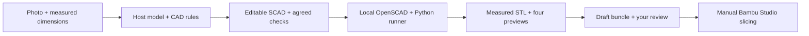

# capture-to-print

Measured OpenSCAD parts with checks, previews and a traceable review bundle — as a **DeepSeek Harness (DSH) bundle** that also carries the same skill and runner a Codex plugin uses.

The host model writes the `.scad` from your photo and confirmed measurements. A local Python runner exports the STL with OpenSCAD, measures declared dimensions, renders four actual-mesh previews and packages the exact revision. Nothing is uploaded, and there is no model API client, paid service, printer dispatch or automatic approval.



## Requirements

- DeepSeek Harness with the `desktop` (or `web`) profile.
- Python 3.11, OpenSCAD, and fontconfig (`fc-match`) on the same machine.
- Node.js 22+ is already part of DSH.

OpenSCAD and fontconfig are system packages; the Python wheels are installed by `scripts/bootstrap.sh`. The plugin does not install either for you.

## Install

1. In DSH open **Plugins → Add plugin** and paste `https://github.com/xrguin/capture-to-print`, or run:

   ```sh
   dsh plugin --profile desktop add github:xrguin/capture-to-print
   ```

   The public alpha repository retains this legacy DSH adapter at version 0.2.0; it does not include the Codex embedded panel.

2. Build the runtime once. The bundle links itself to a stable path on load:

   ```sh
   bash ~/.local/share/capture-to-print/app/scripts/bootstrap.sh --smoke
   ```

   That creates a venv, installs the pinned wheels, checks OpenSCAD/fontconfig, and builds the unchanged plant-label fixture once to prove the chain works. Omit `--smoke` to skip the build; set `CAPTURE_TO_PRINT_HOME` to relocate the runtime.

3. Start a new DSH session and ask:

   > Build and check the unchanged plant-label fixture.

   The `capture-to-print` skill appears in the session skill catalog. If it does not, restart DSH — the catalog refreshes on session start (it refreshed live during testing, but that is not guaranteed).

Manual alternative without the bundle: clone the repo and run `install-dsh.sh`, which links the skill into `~/.dsh/skills`.

## What a run produces

| Artifact | Purpose |
| --- | --- |
| `design.scad`, `design-contract.json` | Editable source and hash-bound expectations |
| `parts/<name>.stl` | Unsliced mesh, coordinates in millimetres |
| `checks.json` | Measured geometry, required results, unassessed properties |
| `previews/` | Face, back, edge, oblique, contact sheet from that STL |
| `build-record.json`, logs | Engine, dependencies, pinned font, diagnostics |
| `review.json`, `state.json` | Exact revision; user acceptance stays pending |
| `manifest.json`, `draft-bundle.zip` | File list, hashes, portable source and rebuild notes |

The packaged fixture measures **48 × 100.05 × 2.6 mm**, with a **10 × 2 mm** straight stake section at Y = 40 mm. Its original SCAD is unchanged (SHA-256 `c4a60cf4b5a093bbc0a0b1162b03608d7101027e495cccc394cc965d8a67f1e9`), and Work Sans Bold is pinned rather than accepting a fontconfig fallback.

## Commands

```sh
# doctor only
python3 scripts/doctor.py

# full runtime + fixture build
bash scripts/bootstrap.sh --smoke

# explicit runs
.venv/bin/python scripts/capture_to_print.py build --source design.scad --contract contract.json --output-root ./runs
.venv/bin/python scripts/capture_to_print.py verify ./runs/<run-directory>
```

`build` accepts one self-contained SCAD file up to 1 MiB and an STL up to 64 MiB, with per-stage timeouts. It has no model calls, no mesh repair, no scaling and no slicing.

## Limits

The checker measures whole-mesh axis extents and section spans, plus basic mesh integrity. It does **not** certify wall thickness, holes/clearances, strength, slicer behaviour or physical fit. A part whose critical requirement cannot be expressed as a supported check should be rejected rather than approximated.

A successful build means **awaiting user review**. Only your explicit acceptance of an exact revision and its hashes approves it; the agent's visual review is a separate record. STL has no unit metadata, so slicing, bed placement and printer profile remain manual.

Photo input on desktop is a file (AirDrop, iCloud Drive, Files). There is no phone client, no hosted execution and no live camera capture in this package.

## Layout

```
skills/capture-to-print/     SKILL.md, CAD rules, workflow/contract reference
scripts/capture_to_print.py  export, measure, render, package, verify
scripts/doctor.py            runtime checks and fix hints
scripts/bootstrap.sh         venv + pinned wheels + optional fixture build
fixtures/plant-label/        unchanged regression source and contract
assets/fonts/                pinned Work Sans Bold, provenance, OFL
lib/index.mjs                DSH plugin: links skill and app path
plugin.json                  Codex plugin metadata over the same skill
tests/                       Python workflow tests + Node link tests
```

## Tests

```sh
node --test tests/*.mjs                          # bundle link behaviour
.venv/bin/python -m unittest discover -s tests   # runner regressions
```

## Licence

MIT. Work Sans is licensed separately under the SIL Open Font License 1.1; see [THIRD_PARTY_NOTICES.md](../THIRD_PARTY_NOTICES.md).
